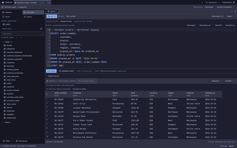
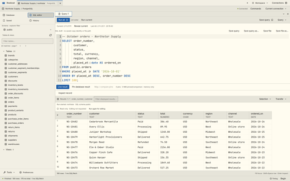

<div align="center">
  
  <h1>Rowboat</h1>
  <p><strong>All SQL. No distractions.</strong></p>
  <p>A fast, native SQL workbench and a CLI that pulls its weight.<br>PostgreSQL · MySQL · SQLite. Built in Rust.</p>
  <p><a href="#get-started">Get started</a> · <a href="#a-proper-cli">CLI</a> · <a href="docs/DAILY-DRIVER.md">User guide</a></p>
</div>

Write queries, explore schemas, edit data, and get back to building. Rowboat pairs
a native desktop app with `rowboatctl`, a terminal workbench built on the same
database engine. Click when it helps. Script when it doesn't.

**Free. Open source. MIT licensed.** No Rowboat account, no subscription, no paid
tier to unlock the good stuff.

<p align="center">
  <a href="assets/launch/themes/rowboat-catppuccin.png"></a>
  <a href="assets/launch/themes/rowboat-flexoki-light.png"></a>
</p>
<p align="center"><sub>Catppuccin (dark) · Flexoki Light. Click a preview to enlarge. All demo data is fictional.</sub></p>

## Less friction. More SQL.

- **Fast where it counts.** Native Rust, streaming results, and a virtualized data
  grid. Built with GPUI Kit and gpui-omarchy, not a bundled browser.
- **An editor that keeps up.** Schema-aware completion, formatting, named
  parameters, snippets, and split panes. Run the current statement, a selection,
  or the whole buffer—you choose.
- **Follow the data.** Filter tables, follow foreign keys, explore relationship
  diagrams, and dig into JSON. Pin results and compare the rows you've loaded.
- **Review before you write.** Stage data edits and supported schema changes,
  inspect the generated SQL, then apply. Conflict checks catch stale row edits.
  SQL you run directly still executes immediately.
- **Keep your place.** Independent connection workspaces, multiple windows, saved
  queries, and searchable history. SQL drafts and layouts recover after a restart;
  your queries don't quietly rerun themselves.
- **Bring your own agent.** A workspace-aware AI sidebar and focused performance
  review through installed Codex, Claude Code or OpenCode V2. Control shared context
  and open suggested SQL without running it. Optional trusted investigation enables
  agent tools with read-only instructions—not confinement. [AI assistance →](docs/AI.md)
- **Connect on your terms.** PostgreSQL and MySQL over TLS or SSH; SQLite straight
  from a file. Passwords stay in memory or your system keyring, not connection JSON.

## Your desktop, your colors

On **Omarchy**, Rowboat follows your current theme automatically—even when you
change it while the app is open. It should look like it lives on your desktop.

**Omarchy isn't required.** Elsewhere, Rowboat follows your desktop's light/dark
preference. Or pick one of **22 bundled palettes**, from Catppuccin to Gruvbox to
Tokyo Night, and keep it. No theme downloads. No desktop settings changed.
[More about themes →](docs/THEMES.md)

## Get started

**Linux and macOS · x86-64 and ARM64.** Native builds, packaging, installation
and GUI startup checks pass CI on all four targets. Windows isn't a launch target.

One [mise](https://mise.jdx.dev/) install gives you **both the desktop app and
the independent CLI**—no Rust toolchain or custom plugin needed:

```sh
mise use -g github:bndnsmth/rowboat@0.2.0

rowboatctl --help              # Explore the CLI
rowboatctl skills get core     # Read the built-in quickstart
rowboat                       # Launch the desktop app
```

Use `@latest` instead of `@0.2.0` to select the newest eligible release. Mise's
release-age policy can delay very new releases; the explicit pin works immediately.

Prefer a download? [Release archives](https://github.com/bndnsmth/rowboat/releases)
include both binaries, an installer and, on macOS, `Rowboat.app`. Mise manages
the commands; use the installer for desktop launchers. macOS bundles are currently
ad-hoc signed, **not notarized**. See the [installation guide](docs/DISTRIBUTION.md)
for runtime requirements and [feature coverage](docs/FEATURES.md) for remaining limits.

Open **Connections** in the desktop app to add a PostgreSQL/MySQL server or open
a SQLite file. The CLI can use the same saved connections without the GUI running.

### Build from source

From a checkout, build both apps with [mise](https://mise.jdx.dev/). The Rust
toolchain is pinned for you.

```sh
mise trust
mise install
mise run release
./target/release/rowboat
./target/release/rowboatctl --help
```

Want a desktop launcher? `mise run package` builds a local archive with both
binaries and an installer. Linux desktop/graphics libraries remain system
dependencies; SQLite and Linux OpenSSL are bundled. See the
[installation and runtime notes](docs/DISTRIBUTION.md).

### A few keys go a long way

| Action | Shortcut |
| --- | --- |
| New SQL tab | `Ctrl+T` |
| Run selection or buffer | `Ctrl+Enter` |
| SQL completion | `Ctrl+Space` |
| Format SQL | `Ctrl+Shift+F` |
| Quick open | `Ctrl+P` |
| Switch editor / results focus | `F6` |

## A proper CLI

**`rowboatctl` is included in the same installation as `rowboat`.** It isn't a
launcher for the GUI. Query databases, inspect schemas,
stream imports and exports, explain query plans, and run backups from your terminal.
The app and CLI share saved connections, so there's no duplicate setup.

For example, with a saved connection named `Development`:

```sh
rowboatctl --connection Development tables
rowboatctl --connection Development structure users

rowboatctl --connection Development --read-only query \
  --sql 'SELECT id, name FROM users LIMIT 10' \
  --format json-envelope --timeout 30s
```

Prefer a direct connection? Use `--url` for PostgreSQL/MySQL or `--database-file`
for SQLite. Supply passwords through `ROWBOAT_PASSWORD`, not in command-line URLs.

Readable tables for people. Structured JSON and deadlines for scripts. Start with
`rowboatctl --help` or read the [CLI guide](docs/AGENT-CLI.md).

### A built-in skill for coding agents

The CLI ships its own Markdown skill guide—no extra files, account or download.
Discovery and help work offline, without a database connection or credentials:

```sh
rowboatctl skills list              # Discover available skills
rowboatctl skills get core          # Short exploration quickstart
rowboatctl skills get core --full   # Complete agent guide and examples
```

Tell your coding agent:

> Read `rowboatctl skills get core --full`, then use `rowboatctl` to inspect the
> database I specify. Start read-only.

The guide covers schema exploration, bounded queries, JSON results, timeouts and
safe write/cancellation semantics. It is guidance for your agent, not an embedded
AI service.

## Make it yours

Fork it. Fix a rough edge. Build the feature you wish your database tool had.
The GUI and CLI share Rust crates for database access, schema tools, and local
services; start with the [architecture](docs/ARCHITECTURE.md) or
[engine adapter guide](docs/ENGINE-ADAPTERS.md).

```sh
mise run dev    # Run the desktop app in development
mise run fmt
mise run check
mise run lint
mise run test
```

Live integration tests use disposable rootless Podman databases, never your saved
connections. See the [testing guide](docs/TESTING.md). When sharing bug
reports or examples, leave out credentials and private data—including sensitive SQL.

[User guide](docs/DAILY-DRIVER.md) · [Feature coverage](docs/FEATURES.md) ·
[Connections & security](docs/CONNECTIONS.md) · [Themes](docs/THEMES.md) ·
[Roadmap](docs/ROADMAP.md)

[MIT licensed](LICENSE). Free to use, change, and make your own.
